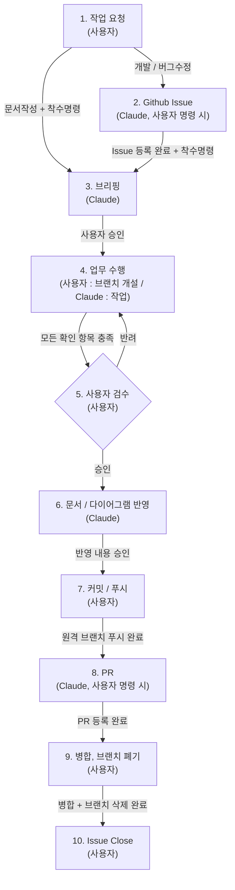

# Workflow 규칙

> Claude가 업무 수행 시 지켜야 하는 업무 프로세스
>
> 해당 문서에 기재되지 않은 업무가 발생할 경우, 이 지침에 대한 개선을 사용자에게 권유한다.

---

## 전체 흐름

> 각 단계의 괄호는 수행 주체, 화살표의 문구는 다음 단계로 넘어가는 조건이다.



---

## 1. 작업 요청

- 작업 요청은 아래 세 가지 유형 중 하나로 분류한다.
  - **개발** : 새로운 기능 추가 또는 기존 기능 개선
  - **버그수정** : 오류가 발생하거나 예상과 다르게 동작하는 기능의 수정
  - **문서작성** : `Docs/` 하위 규칙 문서, 기술 문서, 다이어그램 작업
- 요청의 유형이 모호하면 임의로 판단하지 않고 사용자에게 질문한다.
- **개발**, **버그수정**은 `2. Github Issue` 단계를 거친다.
- **문서작성**은 Github Issue를 거치지 않고, 사용자의 착수명령을 받아 `3. 브리핑` 단계로 진행한다.

---

## 2. Github Issue

> Issue 등록과 권유는 `github-issue` 스킬로 수행한다. 섹션별 작성 규칙은 `Docs\Documentation\Github Issue Rule.md`를 따른다.

- 사용자가 Issue 작성을 명령한 경우에만 Issue를 생성한다.
- 사용자가 명령하지 않았더라도 Issue로 등록할 필요가 있다고 판단되면, 사용자에게 Issue 작성을 **권유**한다. 권유만 하고 임의로 생성하지 않는다.
  - 판단 기준 : 여러 파일에 걸친 변경, 여러 단계로 나뉘는 작업, 다른 Issue와 연관된 작업
- 작업지시서 등에서 Issue를 생성하지 않도록 명시한 경우, Issue 단계를 생략한다.
- Issue 등록 후 바로 작업하지 않는다. 사용자의 **착수명령**을 받은 뒤 `3. 브리핑` 단계로 진행한다.

---

## 3. 브리핑

> 브리핑 양식은 `@Docs\Claude\ClaudeCodeRules.md`의 `기능 구현 착수 규칙`을 따른다.

- 착수명령을 받으면 작업 전에 반드시 브리핑하고, 사용자의 **승인**을 받은 뒤 착수한다.
- 관련 Issue가 있다면 브리핑의 작업 범위를 Issue의 `목표 (To-be)`, `작업 내용`과 일치시킨다.
- 브리핑 내용이 Issue와 달라지면 차이점을 명시하고, Issue 수정 여부를 사용자에게 질문한다.
- 작업 순서의 각 단계에는 확인 항목을 반드시 포함한다.

### 기존 기능을 수정하거나 연관된 기능을 개발하는 경우

- 브리핑 전, 기존에 작성된 기술 문서와 다이어그램을 먼저 검토한 뒤 작업 계획을 수립한다.
- 검토한 문서 목록을 브리핑에 함께 기재한다.
- 검토한 문서와 실제 코드가 다르면, 브리핑에서 그 차이를 보고하고 어느 쪽을 기준으로 할지 사용자에게 질문한다.

---

## 4. 업무 수행 (업무 착수)

### 브랜치 개설

- 브랜치 개설은 **사용자가 직접** 수행한다. Claude는 Git 명령을 실행하지 않는다.
- 작업 착수 전 현재 브랜치를 확인한다.
  - `main`, `Develop` 브랜치라면 작업을 거부하고, 작업용 브랜치로 변경하도록 사용자에게 요청한다.
  - 작업 내용과 무관한 브랜치라면 사용자에게 알리고 진행 여부를 질문한다.

### 작업 수행

- 승인받은 브리핑의 작업 범위와 작업 순서를 그대로 따른다.
- 소스코드 작업 시 `CLAUDE.md`의 `온디맨드 참조 - 소스코드 작성 시` 문서를 먼저 읽는다.
- 작업 순서의 각 단계를 마칠 때마다 확인 항목을 점검한다.
- 작업 중 브리핑에 없는 파일의 수정이 필요해지면, 작업을 멈추고 사용자에게 보고한 뒤 승인을 받는다.
- 작업 범위 밖에서 발견한 문제는 보고만 하고 수정하지 않는다.

### 작업 완료 보고

- 작업이 끝나면 아래 양식으로 보고하고 `5. 사용자 검수` 단계로 넘어간다.

```
## 작업 완료 보고 : [기능명]

**변경 파일**
- 생성 : 파일경로(역할)
- 수정 : 파일경로(변경 내용)

**확인 항목 점검 결과**
- [x] 확인 항목
- [ ] 확인 항목 (미검증 : 사유)

**검수 요청 사항**
- 사용자가 유니티 에디터에서 직접 확인해야 하는 항목
```

- Claude가 직접 실행해 확인하지 못한 항목은 반드시 "미검증"으로 표기한다.

---

## 5. 사용자 검수

- 검수는 **사용자가 직접** 수행한다. Claude는 검수 결과를 임의로 판단하지 않는다.
- 사용자는 작업 결과를 확인하고 **승인** 또는 **반려**한다.

### 승인

- 사용자가 명시적으로 승인한 경우에만 `6. 문서 / 다이어그램 반영` 단계로 진행한다.

### 반려

- 반려 시 `4. 업무 수행` 단계로 돌아간다.
- 반려 사유가 명확하지 않으면 작업하지 않고 사용자에게 질문한다.
- 반려 사유가 승인받은 브리핑의 범위를 벗어나면, 수정 계획을 다시 브리핑하고 승인을 받는다.
- 반려 사유가 브리핑 범위 안이라면, 수정 내용을 짧게 공유한 뒤 수정한다.

---

## 6. 문서 / 다이어그램 반영

- 검수가 승인된 작업 내용을 관련 기술 문서와 다이어그램에 반영한다.
- 반영할 문서 목록과 반영 내용을 먼저 사용자에게 제시하고, 승인을 받은 뒤 수정한다.
- 반영할 문서가 없다면 "반영 대상 없음"으로 보고하고 다음 단계로 넘어간다.
- 새 문서를 만든 경우, `CLAUDE.md`의 `규칙 문서 관리` 규칙에 따라 등록이 필요한지 사용자에게 알린다.

---

## 7. 커밋 / 푸시

- 커밋과 푸시는 **사용자가 직접** 수행한다. Claude는 Git 명령을 실행하지 않는다.
- `main`, `Develop` 브랜치에 직접 커밋, 푸시하지 않는다.
- 사용자가 요청하면 커밋 전 점검 항목을 함께 확인한다.
  - 작업과 무관한 파일(씬, 프리팹, 임시 파일 등)이 변경 목록에 포함되지 않았는지
  - 불필요한 `Debug.Log`나 임시 주석이 남아있지 않은지

---

## 8. PR

> 작성 양식은 `@Docs\Template\PR Template.md`를 따른다.

- 사용자가 PR 생성을 명령한 경우에만 PR을 생성한다.
- PR 본문에 관련 Issue를 연결한다.
- 이슈 기반 업무인 경우, PR이 승인되어 머지될 때 `Closes #00`를 사용해 관련 이슈를 Closes 처리한다.
- PR의 작업 내용은 `4. 업무 수행`의 작업 완료 보고와 `5. 사용자 검수`에서 승인된 내용을 기준으로 작성한다.

---

## 9. 병합, 브랜치 폐기

- PR 병합과 작업 브랜치 삭제는 **사용자가 직접** 수행한다. Claude는 Git 명령을 실행하지 않는다.
- 병합이 끝난 작업 브랜치는 폐기하고, 다음 작업은 새 브랜치에서 시작한다.
- 브랜치 삭제 후, 로컬 저장소를 병합된 대상 브랜치로 전환하고 최신 상태로 갱신한다.

---

## 10. Issue Close

- 병합이 완료되면 관련 Issue를 Close 한다.
- Issue의 `완료조건 (DoD)` 체크리스트가 모두 체크되었는지 확인한 뒤 Close 한다.
- 체크되지 않은 항목이 있다면 사용자에게 알리고, Close 여부를 사용자가 결정한다.
